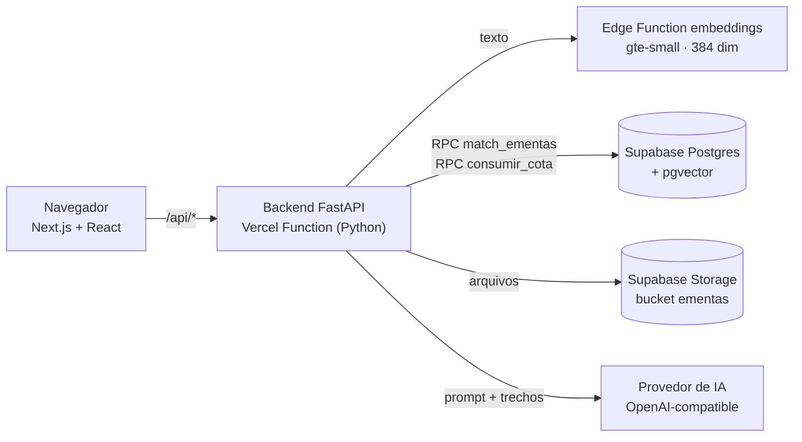

# Eng. Prompt RAG — Plataforma de estudo com IA

Aplicação web em que o aluno estuda o material do curso conversando com uma IA que
**responde a partir das apostilas indexadas e cita fonte e página**. Além de perguntas e
respostas, reúne ferramentas de estudo (Feynman, resolução de questões, glossário,
comparação entre modelos), produção de apostilas e utilitários de arquivo.

| | |
|---|---|
| **Produção** | Vercel — `eng-prompt-rag-final-nenzinhus-projects.vercel.app` |
| **Código** | GitHub `nenzinhu/eng-prompt-rag-final` (privado) |
| **Banco** | Supabase, projeto `eng-prompt-rag` |

> Este documento descreve o projeto a partir do código e da documentação existentes.
> O estado de produção da seção 10 foi conferido em 18/09/2026, só com leituras.

---

## 1. Qual problema resolve

Um modelo de IA genérico responde com conhecimento geral e pode inventar. Este projeto
usa **RAG** (Retrieval-Augmented Generation): antes de responder, busca no material do
curso os trechos mais próximos da pergunta e obriga a IA a se basear neles, com citação
no formato `[Fonte: arquivo, página N]`.

Os prompts do sistema tratam o usuário como **aluno do curso de Engenharia de Prompt**
([api/_app/prompts.py](api/_app/prompts.py)). A ordem dos modelos privilegia os gratuitos
para que o aluno não gaste nada por padrão ([api/_app/provedores.py](api/_app/provedores.py)).

## 2. Funcionalidades

A interface tem 13 abas em 5 grupos ([app/page.tsx](app/page.tsx)).

### Estudar

| Aba | O que faz | Rotas |
|---|---|---|
| **Perguntar** | Resposta com base no material, exibida enquanto é gerada, com os trechos usados como evidência. Ações sobre a resposta: *auditar* (confere frase por frase se há apoio no material), *explicar mais simples*, *testar meu entendimento* (gera 1–2 perguntas de verificação) e *exportar .md* | `/api/perguntar/stream`, `/api/perguntar`, `/api/auditar`, `/api/simplificar`, `/api/verificar` |
| **Professor Sabe Tudo** | Dois modos. **Perguntar** com persona de ensino: Didático, Prático, Socrático, Visual, Acadêmico Detalhista, Preparatório, ou por nível: Inicial, Intermediário, Avançado. **Resumir apostila**: resume um PDF, .docx ou .pptx avulso em etapas (map-reduce), sem indexar | `/api/perguntar*`, `/api/resumir-apostila` |
| **Aprender (Feynman)** | Explica um tema em 3 níveis (Simples, Estudante, Técnico). Depois o aluno explica com as próprias palavras e a IA avalia | `/api/aprender/explicar`, `/api/aprender/avaliar` |
| **Buscar** | Busca semântica bruta no material, sem gerar resposta | `/api/buscar` |
| **Resolver Questão** | Analisa questões de múltipla escolha com IA + RAG. Aceita texto colado ou print/foto, lido por OCR no navegador. Envia os termos técnicos da questão ao Glossário e permite comparar com o gabarito | `/api/resolver` |
| **Glossário** | Extrai termos técnicos do material e explica de forma simples. Os termos ficam salvos no banco e podem ser consultados depois | `/api/glossario`, `/api/glossario/termos` |
| **Comparar Modelos** | Faz a mesma pergunta a vários modelos e aponta onde divergem (números, nomes, conclusão). "Onde eles discordarem é onde vale estudar" | `/api/comparar` |

### Produzir

| Aba | O que faz | Rotas |
|---|---|---|
| **Gerador de Apostilas** | A partir de um tema, a IA escreve uma apostila completa e entrega em **PDF ou DOCX**. Usa o material indexado quando há algo sobre o tema e, se não houver, segue com conhecimento geral | `/api/gerar-apostila` |

### Arquivos

| Aba | O que faz | Rotas |
|---|---|---|
| **Comprimir Arquivos** | Reduz PDFs e imagens **no próprio navegador**, antes do envio | — |
| **PDFs** | Envio de materiais (PDF, TXT, MD, DOCX, PPTX), prévia e execução da reindexação e detecção de duplicatas. **Restrita ao administrador** | `/api/pdfs`, `/api/upload`, `/api/ingerir/previa`, `/api/ingerir`, `/api/duplicatas` |

### Comunicar

| Aba | O que faz | Rotas |
|---|---|---|
| **Perfis Comportamentais** | O usuário cola uma mensagem recebida e escolhe o tom da resposta que protege seus limites: colérico, estoico, reservado, empático-firme ou protetor | `/api/perfis-comportamentais`, `/api/perfil-comportamental` |
| **Elenco — Fale o que pensa** | Aba com dois modos. **Fale o que pensa**: o usuário escreve o rascunho do jeito que sair; a IA diz o que ele quis dizer, analisa como o texto pode soar e devolve a mensagem melhorada na personalidade escolhida: automático, direto, diplomata (indireto), para o(a) ex, papo de amigo, lição de moral, agir correto, desabafo sincero ou cobrança educada. **Puxar assunto**: o Elenco original, que gera uma mensagem com gancho de assunto (debatedor, curiosa, nostálgico, resenha, paquera etc.) | `/api/fale-personas`, `/api/fale-o-que-pensa`, `/api/elenco-personas`, `/api/elenco-conversa` |

### Suporte

| Aba | O que faz | Rotas |
|---|---|---|
| **Tecnologia — Suporte em TI e IA** | Atendimento por especialista. O usuário descreve o ambiente e cola o problema ou o log. *Suporte geral*: Byte, Sam, Bolt, Nexus. *Firmware e UEFI*: Kernel, Trace, Vault | `/api/suporte-personas`, `/api/suporte-atendimento` |

Rotas de apoio: `/api/status` (estado do índice, cache de 30 s), `/api/config`,
`/api/providers`, `/api/admin/login` e `/api/admin/verificar`.

## 3. Arquitetura



### Caminho de uma pergunta

1. O navegador envia a pergunta, o provedor e o modelo escolhidos.
2. O backend aplica o limite de uso em duas camadas:
   - **na memória da instância:** 20 chamadas por minuto por IP, sempre ativo;
   - **no Supabase**, pela função `consumir_cota` e compartilhado entre instâncias: por minuto e por dia por IP (300) e um teto diário global (5000). Só funciona com a `service_role` configurada e a migração aplicada. Se o banco falhar, vale apenas a primeira camada.
3. A pergunta vira um vetor na Edge Function `embeddings`, com o modelo `gte-small`, nativo do Supabase.
4. A função `match_ementas` devolve os trechos mais próximos da tabela `ementas_chunks`.
5. O backend monta o contexto com fonte e página e chama o modelo escolhido.
6. A resposta volta em NDJSON enquanto é escrita (`/api/perguntar/stream`).

### Ingestão de material (administrador)

Envio para o Storage → extração do texto por página → divisão em trechos de ~900
caracteres com 120 de sobreposição, respeitando parágrafos e frases
([api/rag_core.py](api/rag_core.py)) → embeddings → gravação em lotes.

Antes de apagar o índice de um documento, o backend compara quanto texto o arquivo novo
cobre. Se cobrir **menos de 60%** do que está indexado, responde `409` e exige
confirmação explícita.

## 4. Stack

| Camada | Tecnologia |
|---|---|
| Frontend | Next.js 15.5, React 19, TypeScript 5.9, Tailwind 3.4, GSAP (animações), lucide-react (ícones), react-markdown + remark-gfm |
| Processamento no navegador | pdfjs-dist e pdf-lib (PDF), mammoth (.docx), tesseract.js (OCR) |
| Backend | Python, FastAPI, httpx, pypdf + fonttools, python-docx, python-pptx, fpdf2 |
| Dados | Supabase: Postgres + pgvector, Storage, Edge Functions (Deno) |
| IA | Groq, Nous Portal, NVIDIA NIM, AnyAPI, Orca Router, OpenRouter — todos por API OpenAI-compatible |
| Hospedagem | Vercel: Next.js mais função Python `api/index.py`, `maxDuration` de 60 s |
| Qualidade | pytest, ruff, eslint, tsc, `node --test`, GitHub Actions |

## 5. Dados

### Tabelas e armazenamento

| Recurso | Conteúdo |
|---|---|
| `ementas_chunks` | Trechos do material: `id`, `content`, `embedding vector(384)`, `source`, `page`, `created_at` |
| `glossario_termos` | Termos gerados pelo Glossário (`termo_normalizado` é coluna gerada) |
| `cota_uso` | Contadores do limite de uso; só a `service_role` acessa |
| bucket `ementas` | Arquivos originais do material (privado) |

### Acervo indexado (backup de 09/09/2026)

| Documento | Trechos |
|---|---:|
| `Empreendedorismo_Inovacao_Tecnologia_completo.pdf` | 384 |
| `Praticas_Gerenciais_Inovacao_Empresarial.pdf` | 132 |
| `Nous_Portal_Model_Prices - Summary.pdf` | 7 |
| `Empreendedorismo_Inovacao_Tecnologia.pdf` | 2 |
| `Logica_Programacao_Python.pdf` | 1 |
| **Total** | **526** |

A estrutura completa do banco está em
[supabase-backup/recriar-banco.sql](supabase-backup/recriar-banco.sql). As migrações
ficam em [supabase-backup/migracoes/](supabase-backup/migracoes/).

## 6. Segurança e limites

- **Chaves separadas:** a leitura usa a chave pública (anon); a escrita e o Storage usam a `service_role`, que só existe no servidor.
- **RLS:** migrações de 10/09/2026 deixam leitura pública e escrita exclusiva da `service_role`.
- **Administrador:** usuário e senha geram uma sessão assinada válida por 8 h, enviada no header `X-Admin-Token`. Sem `ADMIN_TOKEN` configurado, as rotas de escrita respondem `503`. O login aceita 8 tentativas por IP a cada 15 min (`LIMITE_LOGIN_ADMIN`), na memória da instância e, com a `service_role`, também compartilhado no Supabase.
- **CORS:** restrito às origens de `ALLOWED_ORIGINS`.
- **Upload:** 4 MB na Vercel, porque a plataforma recusa corpos acima de 4,5 MB, e 25 MB rodando localmente. `MAX_UPLOAD_MB` substitui os dois.
- **Envio direto (arquivos grandes):** acima desse teto, a aba PDFs pede uma URL assinada (`/api/upload/url`), o navegador envia o arquivo direto ao Storage em `_envios/<id>/<nome>` e `/api/upload/confirmar` aplica as mesmas regras do upload comum e grava no nome final. Teto de 50 MB por arquivo (limite do Supabase no plano gratuito). Um envio abandonado no meio pode deixar um provisório em `_envios/`, que não é indexado e pode ser apagado no painel.
- **Limite de uso da IA:** 20 chamadas por minuto por IP na instância; tetos por IP e global compartilhados no Supabase quando a `service_role` e a migração de 16/09/2026 estão ativas. O IP é gravado como hash (HMAC), nunca em claro.
- **Tempo:** os timeouts das chamadas de IA são derivados do orçamento de 60 s da função, descontando o tempo já gasto com embedding e busca na mesma requisição.
- **Aviso na interface:** o cabeçalho mostra "⚠ escrita insegura" enquanto o backend grava com a chave pública.

## 7. Estrutura de pastas

```
api/
  index.py              rotas FastAPI, acesso ao Supabase, limites, autenticação
  rag_core.py           núcleo puro (divisão em trechos, heurísticas de comparação, limpeza)
  _app/                 prompts, provedores de IA, extração de documentos, HTTP
app/                    página e layout do Next.js
components/             cabeçalho, navegação, anexos, evidências, markdown
  tabs/                 uma aba por arquivo
lib/                    cliente da API, tipos, hooks, OCR, compressão no navegador
scripts/                backup, smoke test, latência, reconstrução e reimportação
supabase-backup/        SQL, migrações, dumps, PDFs, Edge Function, material reconstruído
tests/                  testes Python (pytest)
tests-js/               testes TypeScript (node --test)
iniciar-tudo.bat        sobe backend e frontend no Windows
instalar-desktop.bat    cria atalho na Área de Trabalho e no Menu Iniciar (janela de app)
```

## 8. Como rodar

### Windows, com um clique

1. Copie [.env.example](.env.example) para `.env` e preencha.
2. Execute [iniciar-tudo.bat](iniciar-tudo.bat). O script cria o `.venv` com Python 3.11, instala as dependências, libera as portas e sobe:
   - backend em `http://localhost:8000` (uvicorn)
   - frontend em `http://localhost:3000` (Next.js)

`instalar-desktop.bat` cria um atalho que abre o app em janela própria.

### Manual

```bash
python -m venv .venv
.venv/Scripts/python.exe -m pip install -r requirements-dev.txt
.venv/Scripts/python.exe -m uvicorn api.index:app --port 8000 --env-file .env
npm install
npm run dev
```

Em desenvolvimento, o Next.js encaminha `/api/*` para `http://127.0.0.1:8000`. Para
usar o backend de produção, defina `BACKEND_URL`.

### Variáveis de ambiente

| Variável | Uso |
|---|---|
| `SUPABASE_URL`, `SUPABASE_ANON_KEY` | Leitura |
| `SUPABASE_SERVICE_ROLE_KEY` | Escrita, Storage e limite de uso (só no servidor) |
| `ADMIN_TOKEN`, `ADMIN_USER`, `ADMIN_PASS`, `SESSION_SECRET` | Acesso administrativo |
| `ALLOWED_ORIGINS` | CORS |
| `GROQ_API_KEY`, `NOUS_API_KEY`, `NVIDIA_API_KEY`, `OPENROUTER_API_KEY`, `ANYAPI_API_KEY`, `ORCAROUTER_API_KEY` | Provedores de IA (só os usados) |
| `LIMITE_LLM_POR_DIA_IP`, `LIMITE_LLM_GLOBAL_POR_DIA` | Tetos diários (0 desliga) |
| `MAX_DURACAO_FUNCAO`, `MAX_UPLOAD_MB` | Orçamento de tempo e limite de upload |
| `BACKEND_URL` | Só em desenvolvimento |

## 9. Testes e qualidade

| Comando | O que roda |
|---|---|
| `python -m pytest tests -q` | 12 arquivos de teste do backend, sem rede |
| `ruff check .` | Lint Python |
| `npm run test:js` | 6 arquivos: leitura do streaming da API, laço de indexação da aba PDFs, nome do arquivo no Storage, redimensionamento de imagem, compressão de PDF e decodificação de preditores PNG/TIFF |
| `npm run lint` / `npm run typecheck` / `npm run build` | eslint, tsc e build |
| `python scripts/smoke.py [--url ...]` | Chama as rotas reais, locais ou de produção |

O GitHub Actions ([.github/workflows/ci.yml](.github/workflows/ci.yml)) roda tudo isso
a cada push na `main` e em pull requests, com Python 3.12 e Node 24.

Outros scripts: `backup_dump.py`, `medir_latencia.sh`, `saude_dos_pdfs.py`,
`comparar_extracao.py`, `comparar_com_indice.py`, `reconstruir_material.py`,
`reimportar_chunks.py` e `verificar-guarda-upload.sh`.

## 10. Estado atual e pontos em aberto

Produção conferida em 18/09/2026, só com leituras (`/api/config`, REST e catálogo do Postgres):

- **Concluído:** a `service_role` está configurada na Vercel (`/api/config` responde `escrita_via: service_role`); o RLS está ligado em `ementas_chunks`, `glossario_termos` e `cota_uso`, com política só de leitura; a migração de cota de 16/09 foi aplicada (`cota_uso` e `consumir_cota` existem); a sequência de ids está à frente do maior id.
- **Ainda sem `REVOKE`:** a chave pública mantém os privilégios de tabela de INSERT/UPDATE/DELETE. O RLS já nega essas escritas; o `REVOKE` seria só uma proteção a mais.
- **Documentos no Storage sem nenhum trecho no índice:** `Praticas_Gerenciais_Inovacao_Empresarial.pdf` (tinha 132 trechos no backup de 10/09; um buraco de exatamente 24 ids, o tamanho de um lote, sugere uma reindexação que falhou por volta de 13/09) e `Playbook do Curso de Prompt Engineering no ChatGPT - DataWay - v1.3.pdf` (nunca indexado). Os arquivos existem, então basta reindexar pela aba PDFs ("Verificar antes de reindexar"). Reenviar o mesmo arquivo não resolve: o upload compara com o Storage e responde "conteúdo idêntico".
- **Material perdido:** 384 dos 526 trechos (73%) vêm de `Empreendedorismo_Inovacao_Tecnologia_completo.pdf`, que não está no Storage. A versão reconstruída em `supabase-backup/reconstruido/` foi gerada de novo em 18/09/2026: sem o marcador "[página N]" no texto, com a folha N sempre igual à página original N, e relida com semelhança mínima de 0,9997. Simulando a reindexação com o código do app: mesmo nome de fonte, 113 páginas, 98,7% do texto atual (a guarda só bloqueia abaixo de 60%), 384 → 228 trechos. Seis páginas ficam sem trecho porque só têm títulos soltos ("SAIBA MAIS"), que o divisor descarta de propósito.
  - **Para reenviar:** na aba PDFs, enviar esse arquivo e esperar "✓ Concluído". Se aparecer "Terminou com pendências", ler o motivo no registro antes de repetir. O pré-requisito (`SUPABASE_SERVICE_ROLE_KEY` na Vercel) já está atendido.
- **Pouco texto extraído:** `Logica_Programacao_Python.pdf` rendeu 1 trecho no backup.
- **Acervo misto:** um resumo de preços de modelos do Nous Portal está indexado junto com as apostilas.
- **Documentação divergente do código:**
  - `README-BACKUP.md` cita o provedor AIHubMix; o código tem AnyAPI e Orca Router.
  - `.env.example` não lista `ANYAPI_API_KEY` nem `ORCAROUTER_API_KEY`.
  - `CORRECOES-2026-09-10.md` fala em 50 e em 58 testes; a busca no código encontra 141 funções `test_` em Python.
  - O script local usa Python 3.11; o CI usa 3.12.

A análise crítica completa pode ser feita com `/analise-4-agentes`.

## 11. Documentos relacionados

- [README-BACKUP.md](README-BACKUP.md) — como o backup foi recuperado e como restaurar o banco do zero
- [CORRECOES-2026-09-10.md](CORRECOES-2026-09-10.md) — correções de segurança, perda de dados e medições em produção
